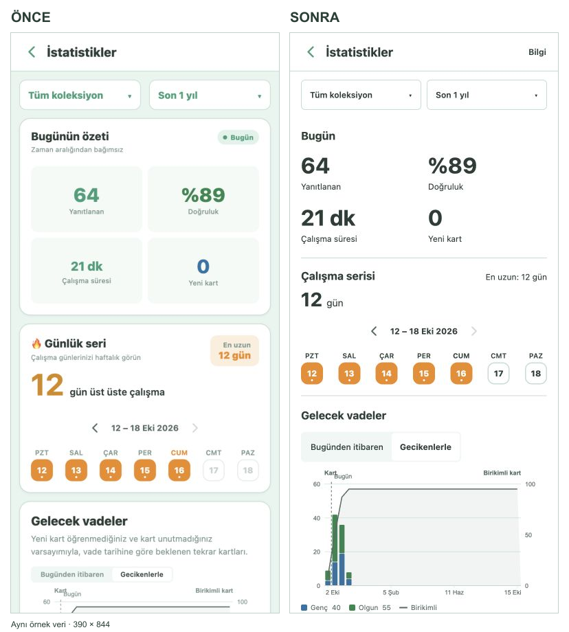

# Statistics simplicity smoke — 2026-10-16

Branch: `codex/canli-oncesi-duzenleme`, based on the web preview's `master`,
`3184f7eec8a20c7044a18cba648f95c0df6fd7d8` (also verified against GitHub before editing).
The original working directory and its uncommitted work were left intact.

The change uses a plain surface and section dividers, removes nested metric boxes, repeated
subtitles, the duplicate Today badge and the decorative streak emoji, and increases metric
label contrast. Chart definitions and instructions remain available in the optional Info
sheet. Data queries, calculations, default range and scope behavior are unchanged.

## Automated checks

- `npm run quality`: passed; 156 files, 1,646 tests; TypeScript and the iOS/source-registry
  verifier passed.
- `npm run build:web`: passed; all 22 static routes exported.
- `lib/chartPressPoint.test.ts`: native local coordinates, browser viewport coordinates and
  missing/invalid positions. This covers the pre-existing RN Web MouseEvent readout failure
  discovered while testing the charts.

## Web checks

Environment: local Metro preview and the production export served on loopback.
Fixture: a temporary synthetic package, 120 cards and 2,008 review-log entries. No personal
collection was replaced. Before and after use the same collection, light theme and 390 × 844
viewport. Today's figures remain 64 answers, 89% accuracy, 21 minutes and 0 new cards.

Passed:

- Light at 390 px, dark at 320 px: readable labels, no horizontal overflow in the overview.
- All statistics sections remain present; metric values and composition percentages remain
  visible. Full paragraphs and repeated chart instructions are absent from the main surface.
- Month/deck changes update `/stats` in place, preserving the other filter; backlog toggles.
- Future Due, Answer Buttons and Review Intervals pin exact-value readouts and dismiss them.
- Added opens the card browser with its `added:` search and destination deck; Back restores
  the statistics scope and range.
- Production export: empty collection, default one-year range and Info open/close work;
  no console errors were recorded on this page.

## Targeted native checks

Device: **iPhone SE (3rd generation) simulator**, iOS 26.4.1 (23E254a).
Build: existing local Debug shell, build 1, loading this branch from Metro on port 8091.
Fixture: an independent SQLite backup of the existing QA collection (20 review-log entries),
placed in a new dedicated `TusAnkiM Stats QA` simulator. The original QA device was untouched.

Passed: light/dark rendering, safe-area header, Info panel opening, panel content scrolling,
grabber tap to dismiss, Reviews count/time switching, accessible Reviews increment action
and a pinned Future Due readout.

Release verification still required: the complete Statistics charts row in
[IOS_RELEASE_CHECKLIST.md](IOS_RELEASE_CHECKLIST.md) on a physical iPhone, including actual
VoiceOver traversal/activation, horizontal-versus-vertical chart gestures, larger Dynamic
Type and the non-empty-bar cases on all charts. This simulator inspection is not a full
physical-device smoke or an App Store release gate.

## Comparison

