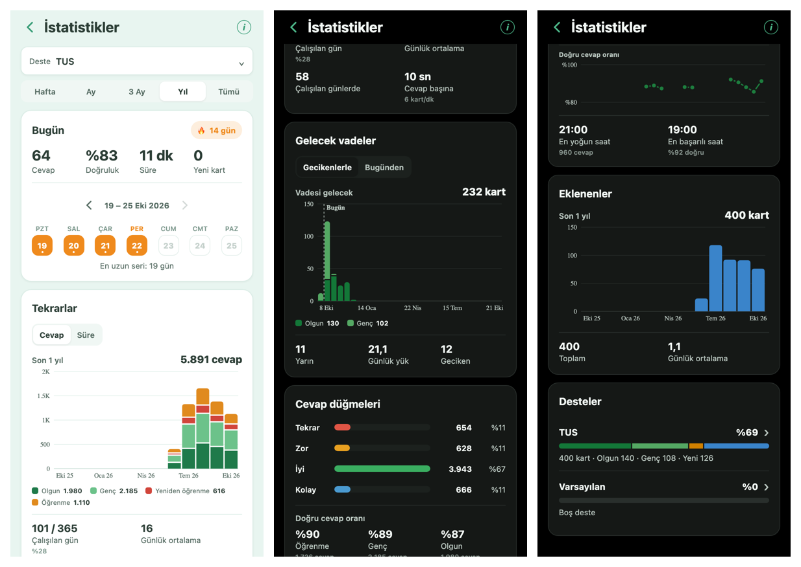

# Statistics redesign smoke — 2026-10-22

Branch: `claude/stats-redesign`, based on `ready` (`79d6d99`). Replaces the 2026-10-16
"simplicity" pass, whose flat single-surface layout read as unfinished.

The screen now puts each section on a rounded card over the page background. A deck selector
and an inline period control (Hafta · Ay · 3 Ay · Yıl · Tümü) sit at the top and update the
screen in place; the custom date range and its modal were removed. Today and the study streak
share the first card. All graphs use `StatsBarChart` (caption readout, tap/slide selection,
VoiceOver adjustable); the older dual-axis `ClassicStatsBarChart` and its `chartPressPoint`
helper were deleted with their test. Answer Buttons are four plain bars. While a new deck or
period loads, the cards dim and stay in place rather than being pushed down by a banner.

## Data change

Review Intervals dropped empty buckets, so its bars were not evenly spaced in days, and its
labels were hard-coded Turkish. `getIntervals` now returns contiguous `{ firstIvl, lastIvl,
count }` buckets from one day up, and `intervalsBeyondRange` counts the review cards past the
period's cap that the chart leaves out. The screen labels the buckets in either language.
Future Due points also carry a readout `detail` (a full date, or a bucket's first and last
day). Pinned by the new case in `lib/ankiStats.test.ts`.

## Automated checks

- `npm run quality`: passed; 158 files, 1,660 tests; TypeScript and the iOS/source-registry
  verifier passed (its App Store legal-placeholder notice predates this change).

## Web checks

Environment: Expo web dev server on loopback, driven by headless Chrome at 390 × 844 @2x,
`tr-TR`. Fixture: the app's own freshly created collection plus a synthetic seed of five
decks (`TUS` and four subdecks), 400 cards in mixed states and 5,891 review-log entries over
120 days. No personal collection was used.

Figures on screen matched independent SQL over the same database: today 64 answers, 83%
correct, 11 min; answer buttons 654 / 628 / 3,943 / 666; 232 review cards, average interval
66 days (shown "2 ay"), longest 197 days ("7 ay"); 11 due tomorrow; 12 overdue; card states
130 / 128 / 126 / 16 = 400.

Passed:

- Light and dark themes: readable labels, no horizontal overflow; the selected period segment
  stands out on the dark track.
- Period "Hafta": stays on `/stats`, the Reviews graph shows seven daily bars (411 answers,
  7 / 7 days, 59 per day), and Review Intervals reports the 193 cards with longer intervals.
- Future Due backlog switch: total 232 → 220 (the 12 overdue cards), the "Geciken" tile hides.
- Tapping the `TUS` deck row rescopes the screen in place: URL unchanged, period kept, the deck
  selector shows `TUS` and its subdecks are listed.
- No page errors or `[Stats]` warnings were logged.

## Release verification still required

The Statistics charts row in [IOS_RELEASE_CHECKLIST.md](IOS_RELEASE_CHECKLIST.md) on a physical
iPhone: VoiceOver traversal and the chart adjustable action, horizontal-versus-vertical chart
gestures, larger Dynamic Type and the Added bar opening the browser. This web run is not a
device smoke.

