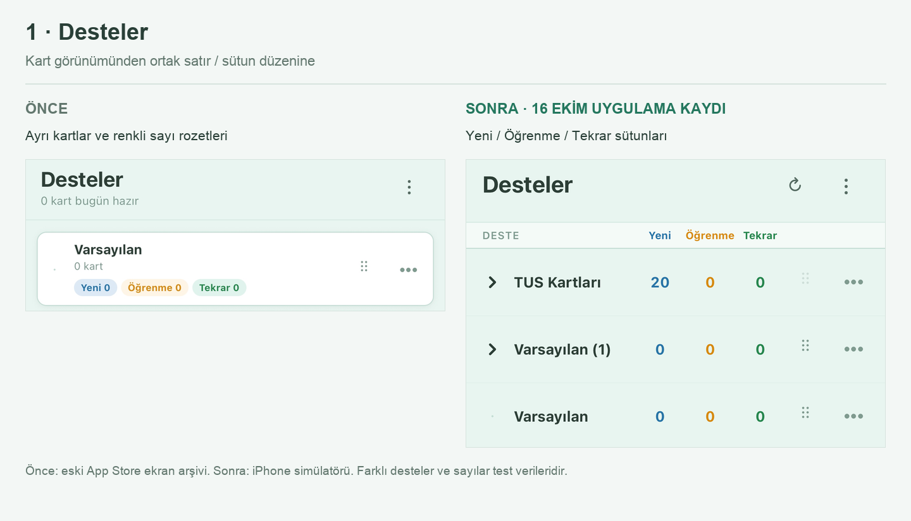
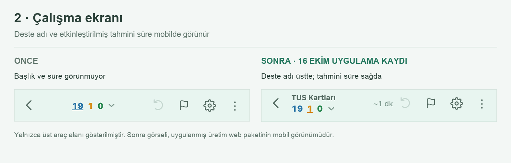
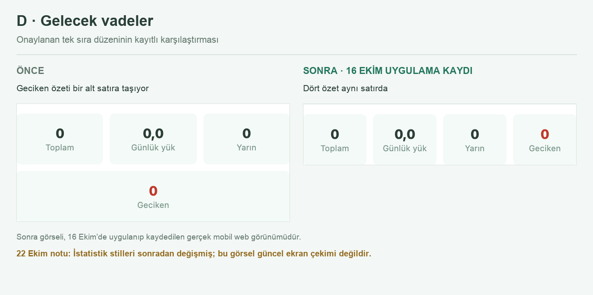
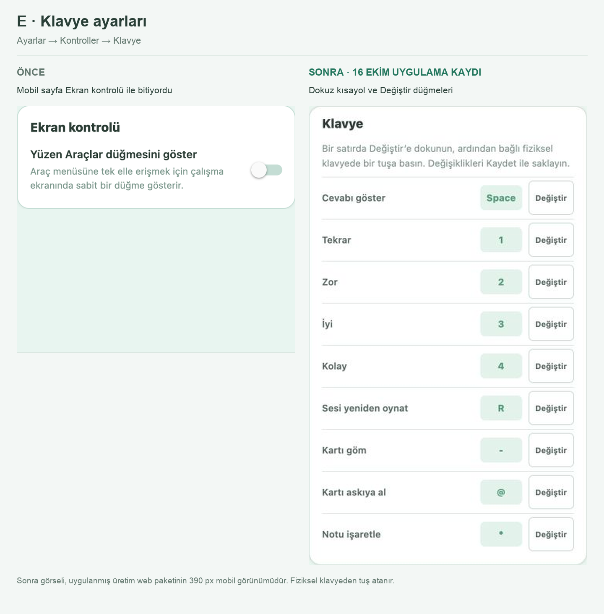

# Mobile layout review

Approved changes and comparison pack assembled on 2026-10-22. The screenshots record the
implementation tested on 2026-10-16; they are not new captures from 22 October. Left is before,
right is the recorded implementation. Test deck names and counts differ between fixtures.

## Commit scope

- Decks uses the same flat name/new/learning/review columns on iPhone and web. Shared header and
  count components keep the widths aligned; compact indentation leaves room for nested names.
- The redesigned reviewer shows the enabled deck title above its counts on a phone, and no
  longer hides an enabled remaining-time estimate. Existing preferences, grading and navigation
  behavior are preserved. Toolbar actions can wrap at narrow widths.
- Keyboard settings (E) are already present on the `ready` base, including native capture and
  deterministic tests; this commit records the approved comparison image.
- Future Due (D) is an archival comparison only. The statistics styles changed afterward; this
  commit does not replace them with the archived layout. A/B/C and the rejected Today proposal
  are not part of this commit. The editor toolbar already has a wrapping preference.

## Before / after

### Decks

The original temporary clipboard files expired. The before panel therefore uses the old card
layout in `docs/app-store/screenshots/00-deste-listesi.jpg`; the after panel is the recorded
QA iPhone simulator table. Different deck names and counts are test fixtures.

### Reviewer toolbar

The after panel is an actual phone-width production-web capture with deck title and the
remaining-time preference enabled.

### D — Future Due (archive)

This is the 16 October implementation record, not a claim about current statistics styling.

### E — Keyboard settings

The after panel is the implemented nine-binding group in a 390px production-web capture.
Only cropping, scaling and layout were used to assemble the screenshots.

## Named verification: phone deck table and reviewer toolbar, 2026-10-16

- Production-web Decks: 320/375/390/600/1024px; count/header centers aligned, Learning stayed on
  one line, no horizontal overflow. Expand child deck, enter study, return and open deck options
  preserved the selected deck and expanded state.
- Production-web reviewer: 320/375/390/430/1024px; enabled title/time visible, toolbar buttons
  did not overlap. Toggle title and time separately, open/close the picker, reveal/grade/undo in
  the redesigned and classic reviewer passed.
- iPhone 17 Pro QA simulator, iOS 26.4, build 1: Decks and reviewer title checked in light/dark
  themes and extra-large text. QA settings were restored after testing.
- Keyboard follow-up: native J/Enter and Turkish Option+Q → @ capture, Cancel and Save passed;
  software keyboard stayed hidden. Web Save/reload/reset passed. Native Escape was not delivered
  by TextInput; use the visible Cancel button. The simulator control connection ended before
  native reopen/reset/reviewer use; the two test bindings were restored independently.
- Physical-iPhone gestures, VoiceOver and Bluetooth keyboard checks remain release gates.

## Commit verification, 2026-10-22

On the isolated `ready` checkout:

- `npm run quality`: TypeScript, 160 test files / 1678 tests, iOS configuration and source registry passed.
- `npm run build:web -- --output-dir /tmp/tus-mobile-layout-ready-web`: production export passed (22 routes).
- `git diff --check`: passed. No fresh physical-device smoke was run for this commit.
